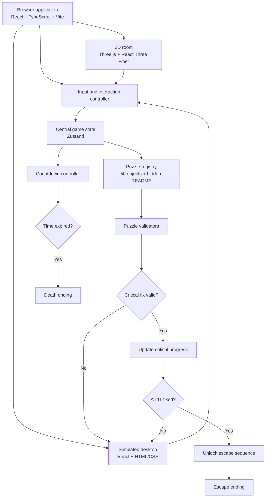

# VEILTRACE

> **Leave no trail. Live to leave.**

VEILTRACE is a browser-based cybersecurity escape thriller. The player wakes up trapped in a dark, bare room and must investigate a fictional computer before a ten-minute containment countdown expires.

The experience combines a cinematic first-person room with a simulated desktop. The player explores apps, files, logs, clues, and hidden content, then identifies and fixes exactly eleven critical security exposures. The game has two endings: escape or death.

## Project status

**Status:** Architecture locked; implementation begins step by step.

This README describes the agreed target architecture. Some folders and files listed below will be created as we implement each step.

## Main theme

VEILTRACE explores how personal information and account security can be compromised through seemingly ordinary digital services. Its story is fictional, but its learning points are based on real security and privacy concepts.

The player must reason from evidence rather than select answers from a multiple-choice quiz. Clues are intentionally short and cryptic; the player discovers the relevant application, investigates the evidence, and performs a simulated remediation.

### Core gameplay constraints

- First-person exploration of one dark room.
- One desk, chair, computer, one locked door, and one overhead light in the opening room.
- The active ten-minute timer starts when the player takes control of the computer, not during the opening cinematic or pre-computer exploration.
- A fictional desktop containing 50 named objects plus one hidden README file: 51 discoverable items in total.
- Exactly 11 designated issues count toward completion.
- Two endings only: escape and death.
- All security actions and data are simulated within the game. The game must not inspect the player's real files, clipboard, browser history, location, or operating-system settings.

## Learning objectives

Players encounter and practise reasoning about:

1. Public profile visibility and oversharing.
2. Live location-sharing links.
3. Geotags in shared images.
4. Location and login history retention/access.
5. Location timelines in backups.
6. Public calendar events and unnecessary address disclosure.
7. Excessive diagnostic or connection-report sharing.
8. Unnecessary background location permissions.
9. Unrecognised active sessions.
10. Exposed authentication tokens.
11. Exposed service credentials and secrets.

The game is educational, not a security scanner. Completing its puzzles does not guarantee that a player's real accounts or devices are secure.

## Locked critical puzzle list

Only the following 11 puzzle IDs count toward the critical completion score.

| ID | Desktop object | Required simulated remediation |
|---|---|---|
| `persona-hub` | Persona Hub | Change public profile visibility to private. |
| `atlas-places` | Atlas Places | Revoke/stop the live location-sharing link. |
| `geoframe-gallery` | GeoFrame Gallery | Remove location metadata from the shared copy. |
| `footprint-log` | Footprint Log | Restrict access to location/login history and reduce unnecessary retention. |
| `roam-backup` | Roam Backup | Exclude the location timeline from future backups. |
| `daymark-calendar` | Daymark Calendar | Make the event private and remove an unnecessary address. |
| `route-trace` | Route Trace | Restrict unnecessary diagnostic/connection-report sharing. |
| `permission-garden` | Permission Garden | Restrict unnecessary background location permission. |
| `session-mirror` | Session Mirror | Revoke the unrecognised active session. |
| `token-cabinet` | Token Cabinet | Mask the exposed token in diagnostics and revoke it. |
| `environment-cabinet` | Environment Cabinet | Mask, protect, and rotate exposed service credentials/secrets. |

The hidden README provides investigation guidance; discovering it must not automatically count as fixing any issue. All other desktop objects are optional/non-scoring unless the design is explicitly revised.

## Technology stack

### Core

- **React** — component-based user interface.
- **TypeScript** — typed game content, state and interactions.
- **Vite** — development server and production build.
- **Three.js** — 3D rendering.
- **React Three Fiber** — React renderer for Three.js; used for the room and 3D interactions.
- **Zustand** — central game state.
- **HTML/CSS** — simulated desktop, windows, menus, dialogue, HUD and settings.
- **Lucide React** — consistent interface icons.

### Quality and testing

- **Vitest** — unit tests for timer, puzzle validation and ending rules.
- **Playwright** — browser-level tests for key player flows.
- **Zod (optional)** — runtime validation of puzzle/configuration data if it proves useful.

### Asset workflow

- **Blender (optional)** — create or prepare custom 3D models.
- **glTF/GLB** — preferred exchange formats for 3D assets where appropriate.
- Browser **WebGL** is the primary compatibility path. WebGPU may be explored later as an enhancement, not as a requirement.

## Architecture principles

1. **Three clear layers:** the 3D world, the simulated desktop UI, and the game rules.
2. **Data-driven puzzles:** puzzle definitions live in a registry; they are not scattered across UI components.
3. **One authoritative game state:** timer, phase, completed critical issues and ending status are coordinated centrally.
4. **Explicit scoring allowlist:** only the eleven locked IDs above can contribute to critical completion.
5. **Deterministic endings:** one ending resolver controls the outcome; visual effects never decide it.
6. **No backend for the first playable version:** the MVP can run client-side with authored fictional content.
7. **Privacy by design:** do not request or inspect real user data, device settings or location.
8. **Accessible interaction:** support keyboard navigation, readable text, clear focus, and settings for audio/motion where practical.
9. **Performance-conscious 3D:** keep the initial scene small, optimise assets, and avoid requiring expensive post-processing.

## Architecture flow



## Planned folder structure

The following is the intended structure. Files will be added gradually; do not create every placeholder manually before the relevant step.

```text
veiltrace/
├── public/
│   ├── audio/                  # Ambience, dialogue, effects
│   ├── models/                 # Optimised GLB/glTF models
│   ├── textures/               # Texture assets
│   └── fonts/                  # Locally hosted fonts, if needed
├── src/
│   ├── app/
│   │   └── App.tsx             # Top-level composition
│   ├── components/
│   │   ├── DialogueBox.tsx
│   │   ├── Countdown.tsx
│   │   └── InteractionPrompt.tsx
│   ├── scenes/
│   │   ├── IntroScene.tsx
│   │   ├── RoomScene.tsx
│   │   └── EndingScene.tsx
│   ├── desktop/
│   │   ├── DesktopShell.tsx
│   │   ├── FileManager.tsx
│   │   ├── AppWindow.tsx
│   │   └── apps/
│   │       ├── PersonaHub.tsx
│   │       ├── AtlasPlaces.tsx
│   │       └── ...             # Other simulated desktop apps
│   ├── puzzles/
│   │   ├── registry.ts
│   │   ├── criticalIssues.ts
│   │   └── validators.ts
│   ├── game/
│   │   ├── gameStore.ts
│   │   ├── timer.ts
│   │   ├── inputManager.ts
│   │   └── endingResolver.ts
│   ├── data/
│   │   ├── objects.ts
│   │   ├── dialogue.ts
│   │   └── clues.ts
│   ├── styles/
│   │   ├── global.css
│   │   └── desktop.css
│   ├── main.tsx
│   └── vite-env.d.ts
├── tests/
│   ├── timer.test.ts
│   ├── scoring.test.ts
│   └── endings.spec.ts
├── .env.example
├── .gitignore
├── index.html
├── package.json
├── tsconfig.json
├── vite.config.ts
└── README.md
```

## Requirements

- Node.js **20.19+ or 22.12+** recommended for current Vite releases.
- npm (installed with Node.js).
- A modern desktop browser with WebGL enabled.
- Git recommended for version control.
- VS Code or another TypeScript-capable editor recommended.

Check versions:

```bash
node -v
npm -v
git --version
```

## Installation and setup

### 1. Create the React + TypeScript project

Run these commands in a terminal:

```bash
npm create vite@latest veiltrace -- --template react-ts
cd veiltrace
npm install
```

If Vite asks interactive setup questions, select the React + TypeScript template.

### 2. Install the core libraries

```bash
npm install three @react-three/fiber @react-three/drei zustand lucide-react
npm install zod
npm install -D @types/three vitest jsdom @testing-library/react @testing-library/jest-dom
```

`@react-three/drei` provides useful helpers for common Three.js tasks. Zod is optional; we can remove it if the project does not need runtime schema validation.

### 3. Optional browser testing setup

```bash
npm install -D @playwright/test
npx playwright install
```

Playwright will be used when we add browser-level tests. It is not required just to start the development server.

### 4. Start the development server

```bash
npm run dev
```

Open the local URL printed by Vite, usually `http://localhost:5173`.

### 5. Production build and preview

```bash
npm run build
npm run preview
```

Vite's build output is normally written to `dist/`.

## Environment variables

**No environment variables are required for the initial MVP.** There is no API server, database, authentication provider or secret key.

An optional `.env.example` may be kept for non-secret public configuration:

```dotenv
VITE_GAME_DURATION_SECONDS=600
```

If we choose to use this setting, copy `.env.example` to `.env.local` and read it through `import.meta.env.VITE_GAME_DURATION_SECONDS`. Vite exposes variables prefixed with `VITE_` to client-side code. **Never put passwords, private API keys or secrets in a `VITE_` variable.**

The ten-minute duration should also have a safe code default of 600 seconds if the variable is missing or invalid.

## Useful scripts

The Vite template supplies development and build scripts. Inspect `package.json` before assuming a script exists.

Typical scripts:

```bash
npm run dev       # Local development
npm run build     # Type-check/build according to the template configuration
npm run preview   # Preview the production build locally
npm run lint      # Lint if included by the scaffold
npm run test      # Add when Vitest is configured
```

If the scaffold does not contain `test`, do not run it until we add the script and test configuration.

## Timer and ending rules

- The opening cinematic and initial room exploration happen before the countdown starts.
- Start the countdown only when the player takes control of the computer.
- Derive remaining time from a stored start timestamp and elapsed time; do not rely on interval tick counts for correctness.
- Decide and test the exact boundary rule for a final fix submitted at the moment the timer expires.
- Escape requires all eleven critical fixes to be validated.
- Expiry before a valid escape triggers the death ending.
- Only the central ending resolver may transition the game into an ending.
- The initial MVP has exactly two endings.

## Development roadmap

1. **Foundation:** scaffold React + TypeScript + Vite, install dependencies, confirm the app runs.
2. **Visual foundation:** establish VEILTRACE's fonts, colours, title screen and global layout.
3. **Room prototype:** build the room, first-person camera, movement and interactions.
4. **Computer interaction:** let the player approach the desk and enter the simulated desktop.
5. **Desktop shell:** implement windows, navigation, context actions, files and keyboard input.
6. **First complete puzzle:** implement Persona Hub end to end, including evidence, clue, remediation and validation.
7. **Puzzle content:** implement the other ten critical puzzles, remaining desktop objects and hidden README.
8. **Game rules:** add the ten-minute countdown, progress HUD and two endings.
9. **Testing and polish:** test boundary cases, controls, accessibility, performance, sound and deployment.

## Definition of done for the first playable version

- The game opens and runs in a desktop browser.
- The player can explore the room and interact with the computer.
- The simulated desktop contains the planned 50 objects and the hidden README.
- Each of the eleven critical issues has an evidence trail and a valid simulated remediation.
- Optional objects do not increase critical progress.
- The active timer starts at the correct moment and expires reliably.
- Exactly two endings can be reached according to the rules.
- No real personal data or device settings are accessed.
- Production build succeeds and core flows have automated or repeatable manual tests.

## Educational disclaimer

VEILTRACE is a fictional learning experience. It demonstrates security and privacy concepts through simulated data and actions. It does not scan or secure the player's real devices or accounts, and its puzzle outcomes are not a guarantee of real-world security.


